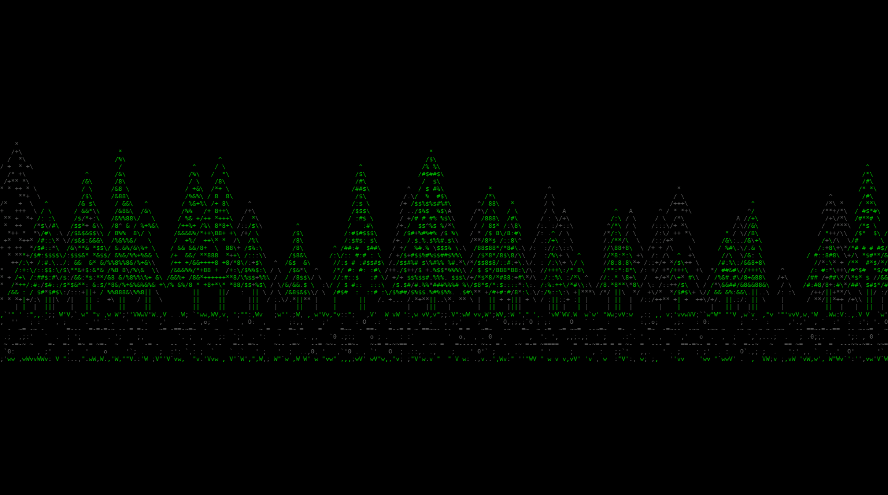

# bean-headunit

A homemade head unit for my 2001 Mazda Miata (NB, British Racing Green), built on a Raspberry Pi 5.

Off-the-shelf stereos have bad interfaces outside of CarPlay, and their firmware is locked down. With a Pi underneath, it's just Linux, and I get to decide everything: what shows up when the car starts, what data from the car gets shown, and how the controls work.



## Where it's at

- [x] Pi OS Lite trimmed for a fast boot: 4.8 s on the Pi 5, down from 14.8 s fresh ([details](docs/boot-time.md))
- [x] An ASCII boot splash of the car that plays from early in boot ([details](docs/splash.md))
- [x] A shared data contract in Rust and a fake core that streams car data over a Unix socket ([details](docs/architecture.md))
- [x] A first Slint UI window that shows live water temp and rpm from the core, and reconnects on its own when the core restarts ([details](docs/architecture.md#the-ui))
- [x] The cluster skin's Home screen: design tokens, night and day themes, the Saira font, a top bar, a nav bar, and live water temp and volts ([details](docs/architecture.md#the-cluster-skin))
- [x] Runs on the Pi without a desktop: the UI takes over from the splash at boot, as its own locked-down user, installed with one script ([details](docs/pi-setup.md#7-install-the-head-unit))
- [ ] The other screens (Gauges, Trip, Codes, Setup), and tapping the nav bar to switch between them
- [ ] The core: OBD2 over USB for live data and trouble codes, trip logging, warnings
- [x] CarPlay proof of concept: my own Rust code starts a wireless session through a USB dongle and receives video that decodes cleanly ([details](docs/carplay.md))
- [x] CarPlay video live inside the UI, as a desk prototype ([details](docs/carplay.md))
- [ ] CarPlay finished: touch, audio, and switching to and from the other screens
- [ ] Bluetooth hands-free calls when CarPlay isn't running
- [ ] Physical controls in place of the ashtray: a volume knob (click to pause, double click to skip, hold for Siri), a USB-C port, and a screen-off switch
- [ ] Car power handling: ignition sense, safe shutdown, read-only root filesystem
- [ ] Later: an ESP32 with its own sensors for data OBD can't give

For now it sits on my desk on a 1440p display until the car is back and I can measure the dash for the real screen.

## How it fits together

```
beand (the core, in the car)  ─┐                      ┌─▶ bean-ui + a skin   (the screen)
                               ├─▶ Unix socket ───────┼─▶ web dashboard      (later)
bean-sim (fake core, at desk) ─┘   MessagePack frames └─▶ dump               (debugging)
```

The core owns everything that has to keep working no matter what's on screen, so a UI crash never stops logging or warnings. The UI loads its look from a skin folder at runtime, so the current design is just one skin. `bean-sim` speaks the same protocol as the core, which is how I build the UI at my desk without the car. More in [docs/architecture.md](docs/architecture.md).

## Try it

On a laptop (macOS or Linux) with Rust installed through [rustup](https://rustup.rs) and FFmpeg's development libraries (on a Mac, `brew install ffmpeg pkg-config`):

```
cargo test
cargo run -p bean-sim                       # terminal 1: the fake core
cargo run -p bean-ui                        # terminal 2: the UI window with live values
cargo run -p bean-model --example dump      # or this: prints the live car state
```

The UI can start before or after the sim. Without a core it shows NO CORE and keeps retrying. `BEAN_TITLE` sets the name in the top bar (default `MIATA`), and `BEAN_UNITS=c` shows °C instead of °F.

To build the Pi itself from a blank SD card, follow [docs/pi-setup.md](docs/pi-setup.md). After the OS setup, it's one script: `system/install.sh`.

## What's in here

```
bean-headunit/
  Cargo.toml        Rust workspace
  model/            bean-model: the data contract shared by the core, UI and sim
  sim/              bean-sim: a fake core that streams made-up car data
  ui/               bean-ui: the Slint window that shows the car state
  skins/            the UI's look, one folder per skin (cluster/ is the current one)
  log/              bean-log: the shared logger every program uses
  carplay/          bean-carplay: talks to the CarPlay dongle over USB
  splash/           the boot animation (Python) and its systemd service
  system/           install script, systemd services, and the example config
  docs/             setup guide, architecture, boot time, splash
  notes/            raw boot time measurements
```

## Docs

- [Pi setup](docs/pi-setup.md): from a blank SD card to booting into the splash and the UI
- [Architecture](docs/architecture.md): the core and UI split, the contract, and the wire format
- [Boot time](docs/boot-time.md): measurements, what helped, and what didn't
- [Boot splash](docs/splash.md): how it works, rebuilding it, and its settings
- [CarPlay](docs/carplay.md): the dongle, its USB protocol, and everything learned about it so far
