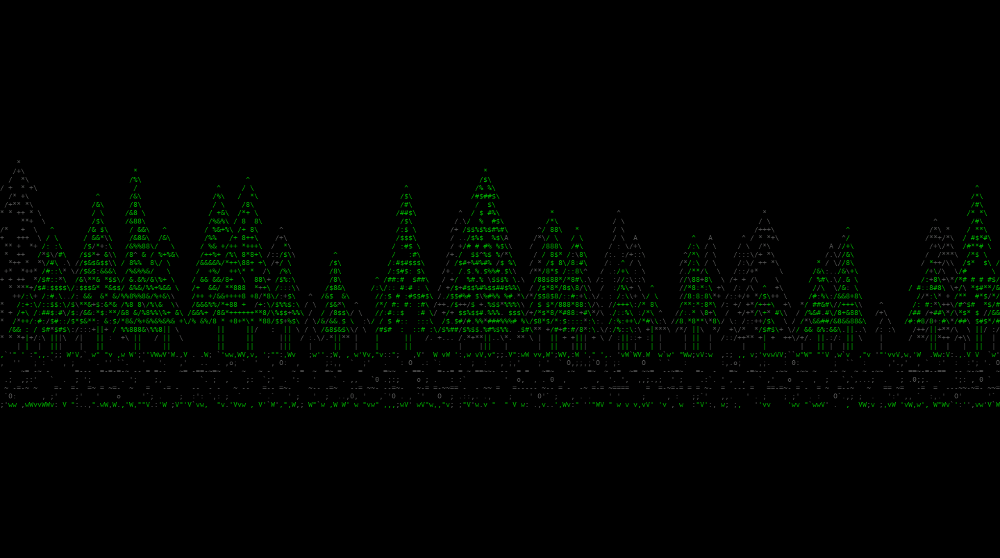

# The boot splash



The car slides in through a forest at night on a dirt road, brakes hard, stops in the middle of the screen, flashes its high beams, and the name slams in. Then it idles, with stars twinkling and headlights glowing, until the real UI takes over.

Everything on screen is text. The trees, stars, road, dust, and headlight beams are ASCII, and so is the car: its outlines are matched to the shapes of characters like `/ \ _ | ( )`. The Pi's console can't show braille, but normal terminals can, so over SSH the car is drawn in braille dots instead because it looks sharper.

All the drawing happens ahead of time in `build_frames.py`, so the Pi doesn't do any image work at boot. `splash.py` just loads one file and prints text, which lets it start very early.

It's installed by `system/install.sh`, see [step 7 of the setup guide](pi-setup.md#7-install-the-head-unit).

## Files

```
splash/
  splash.py                plays the boot animation (plain Python, no packages)
  frames/                  the pre-rendered animation
  bean-splash.service      systemd unit that starts it at boot
  build_frames.py          renders the animation into frames/
  verify_frames.py         checks rendered frames for glitches
  preview_gif.py           makes a GIF from a frames file
  preview_screen.py        makes a GIF of the whole screen as the Pi shows it
```

## Making it yours

The name, timing, colors, and ASCII character sets are at the top of `build_frames.py` (the name is `NAME`). The line under the animation is the `SPLASH_TAGLINE` setting (see below), so changing it doesn't need a rebuild. The car is traced from a side photo of an NB with the hardtop; changing its shape means editing the coordinates in the car section of `build_frames.py`.

Rebuilding is easiest on your own computer:

```
pip3 install pillow numpy pyte
cd splash
python3 build_frames.py                     # about a minute
python3 verify_frames.py frames/*.json      # check for glitches
python3 preview_screen.py screen.gif        # see the whole screen as the Pi will show it
```

Then commit the new `frames/*.json`, `git pull` on the Pi, and run `system/install.sh` again to copy them into place.

`preview_screen.py` assumes a 1080p screen (240 x 67 characters). For another size, pass it in: `python3 preview_screen.py screen.gif 320 90` for a 1440p screen. Run `stty size` on the Pi's own screen to see yours (it prints rows, then columns).

You don't have to rebuild for a different screen. `splash.py` reads the console size when it starts, picks the biggest car that fits, centers it, and fills the extra sky with stars. On a bigger screen the car just takes up less of it.

For a solid white car on the console instead of an ASCII one, build with `python3 build_frames.py --console-car blocks`.

## Settings

Put these in `/etc/bean-headunit/bean.env` on the Pi, one `NAME=value` per line. They override the defaults in the service file and take effect on the next boot.

| Setting | Default | What it does |
| --- | --- | --- |
| `SPLASH_TAGLINE` | `Mazda MX-5 Miata` | The line typed under the car after it stops |
| `SPLASH_PREROLL` | `2.0` | Seconds to hold the empty scene before the car drives in, so the screen has time to wake up. The service file sets it to `0.3`, tuned for my current display |
| `SPLASH_WAIT_MAX` | `10` | Longest to wait for the screen to be ready before starting anyway |
| `SPLASH_STYLE` | auto | `half` for the console version, `braille` for the terminal version |
| `SPLASH_ONCE` | off | `1` exits after the intro instead of looping |

## Good to know

It looks different over SSH. Your terminal's font and colors are much softer than the Pi console's, which only has 16 harsh colors ("green" is bright green and "yellow" comes out orange). `preview_screen.py` is the closest thing to the real screen.

If the start gets cut off, your screen is slow to wake up after the Pi switches video modes. Raise `SPLASH_PREROLL` to 1, or up to 3 or 4 for a slow monitor.

You might occasionally catch a tearing line. The Linux console has no vsync. The splash only redraws characters that changed and never clears a line, which hides almost all of it. A graphical UI won't have this.

The splash loops until the UI takes over. It's a `Type=notify` service: once the car has stopped and the tagline is typed, it tells systemd it's ready (`READY=1` on the socket in `NOTIFY_SOCKET`). `bean-ui.service` is ordered `After=` it, so the UI starts only after the intro is done. The UI then tells systemd it's ready once it has drawn its first frame, and its `ExecStartPost=` stops the splash at that moment. So the splash stays on screen while the UI starts up, and there's no blank gap between them. If boot is slow, the splash keeps looping its idle part until then. If the splash fails, the UI starts anyway, because `After=` only sets the order.

(A `Conflicts=` between the two looks like the obvious way to do this, but it doesn't work at boot: both start jobs are queued together, and systemd drops the stop instead of running it, so the splash keeps running behind the UI.)
